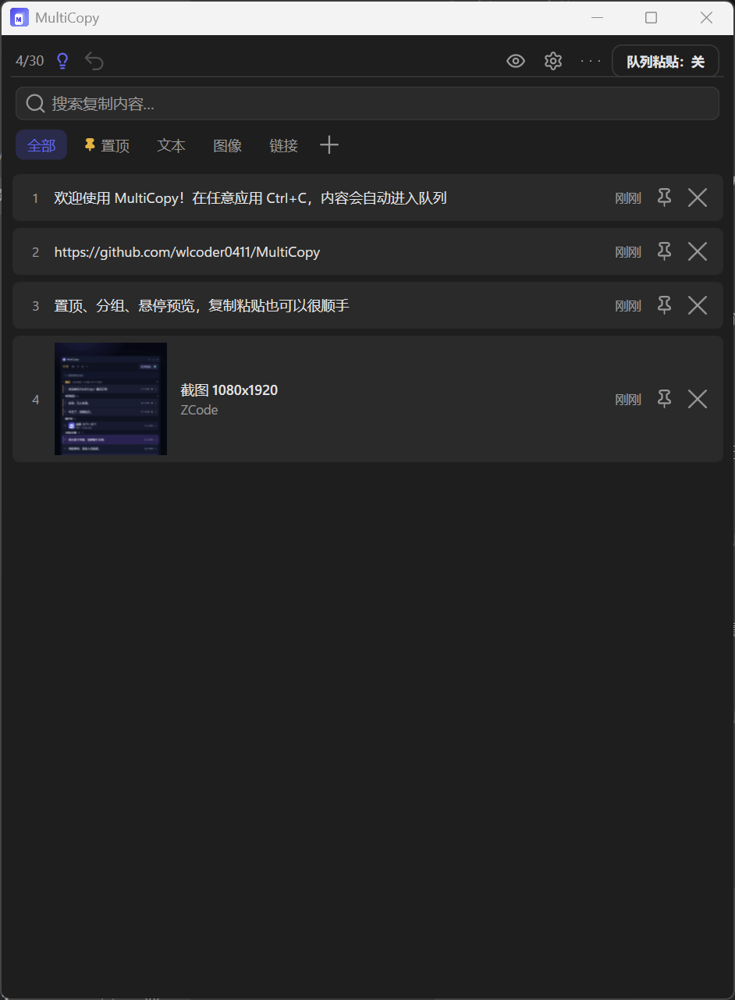
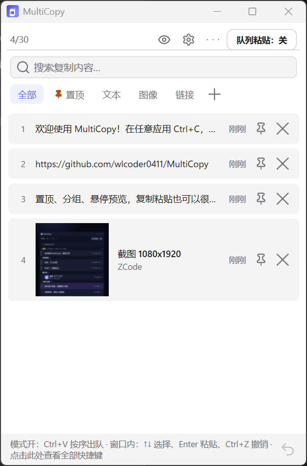
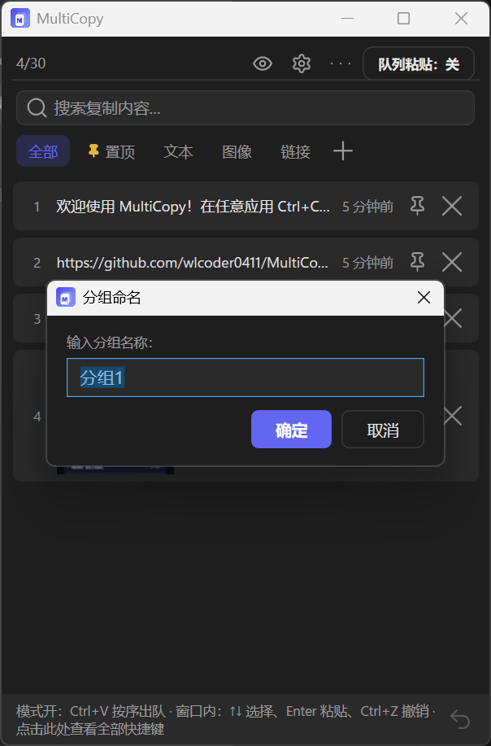
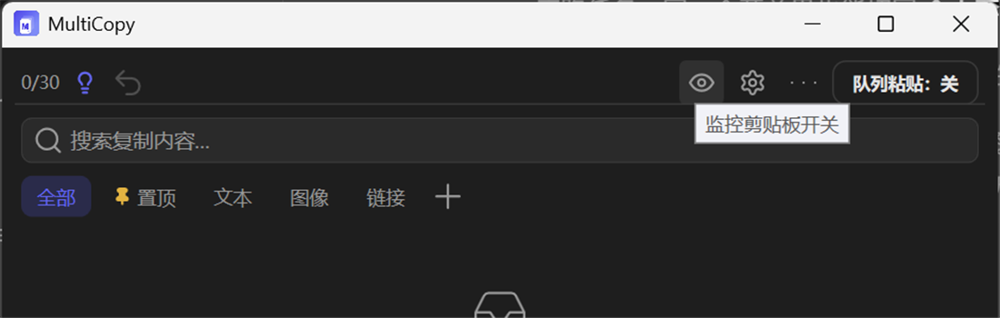
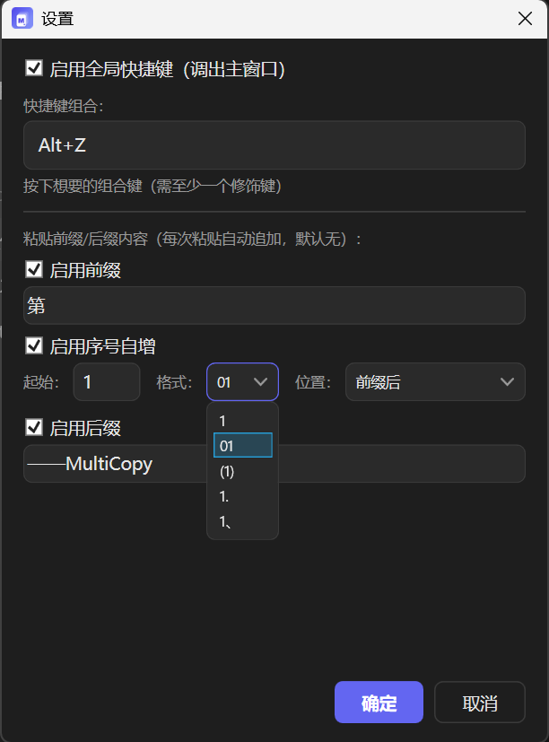
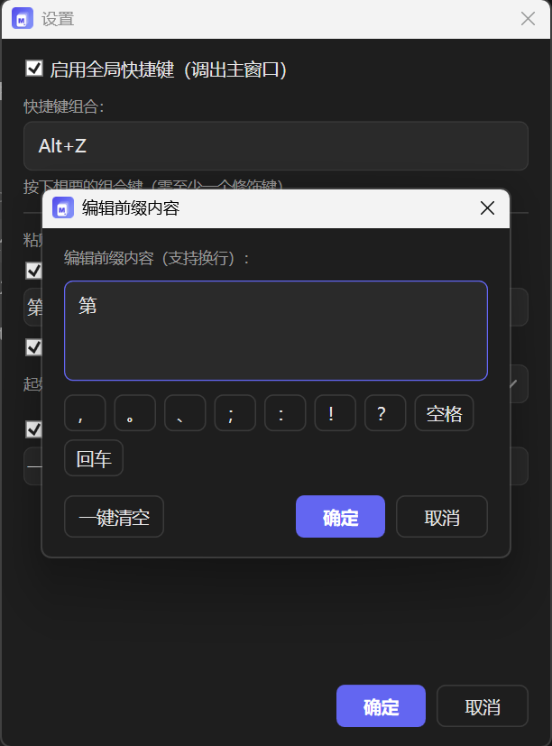

# MultiCopy

> Windows 桌面多段复制粘贴工具：连续复制多条文本或图片，再按队列顺序或选择性粘贴。

[](LICENSE)
[](https://dotnet.microsoft.com/)
[](#)
[](../../releases)


MultiCopy 解决一个常见痛点：整理资料、填写表单、收集素材时，要在多个窗口间反复切换复制粘贴。它把你连续复制的每一段内容自动收集进队列，然后你可以按 `Ctrl+V` 一条条顺序粘贴，或点击任意条目选择性粘贴。

支持文本与图片、置顶常驻、横向标签式分组与文本/图像/链接类型筛选、图像悬停预览、粘贴前后缀与序号自增、相对时间、按行拆分、拖拽导出、明暗主题、托盘常驻与全局热键。

## 功能特性

### 采集与去重

- **多段连续采集**：后台监听剪贴板，每次复制自动入队，无需手动操作
- **普通队列上限 30 条**：置顶项与置顶分组不占容量；顶部左侧显示 `n/30`，达到上限后变黄并停止采集新内容，托盘气泡提示清理
- **自动去重**：同一分组（或未分组区）内相同文本不会重复入队，避免 Word 等应用在文档变更后重复广播剪贴板造成重复条目；图片在 1.5 秒内同尺寸、同哈希视为重复
- **粘贴回音抑制**：队列粘贴后目标应用把内容写回剪贴板时不会再次入队
- **监控开关**：一键开启 / 关闭剪贴板监控；窗口隐藏到托盘时自动关闭，恢复显示时自动开启

### 粘贴与编辑

- **队列粘贴**：开启顶部「队列粘贴」模式后，`Ctrl+V` 逐条按顺序粘贴队首并出队
- **选择性粘贴**：单击普通项粘贴并移除；双击置顶项粘贴但保留
- **粘贴前后缀**：前缀 / 后缀可独立开关，支持多行编辑与中文标点、空格、回车等预设
- **序号自增**：前缀支持自动递增序号，5 种格式（`1` / `01` / `(1)` / `1.` / `1、`）× 2 种位置（前缀前 / 前缀后），可从 `⋯` 菜单一键重置
- **撤销**：`Ctrl+Z` 撤销最近一次粘贴或删除，最多回退 8 步；批量清空或按行拆分后撤销记录会被清空
- **键盘优先**：窗口内 `↑↓` 选择、`Enter` 粘贴、`Del` 删除、`Esc` 清空搜索 / 隐藏窗口

### 队列管理

- **横向标签栏**：`全部 · 置顶 · 各分组 · 文本 · 图像 · 链接 · ＋` 横向排列在搜索框下方，分组再多页面也不再拉长；标签溢出时鼠标滚轮横向滚动
- **分组标签**：点击分组标签即设为活动分组，新复制内容归入该组，`Ctrl+V` 只消耗该组；点「全部」回到全局模式
- **类型筛选标签**：「文本 / 图像 / 链接」跨置顶 + 未分组 + 所有分组按内容类型筛选（URL 文本归「链接」），多类内容混合收集时快速切换
- **置顶常驻**：置顶项有独立标签；「全部」视图顶部仍显示置顶区。置顶项跨会话保存，双击粘贴但不出队
- **置顶分组**：整组置顶（标签带 📌、排在最前），组内项双击粘贴并保留，不参与自动出队；置顶分组仅查看，不接收新复制内容
- **分组管理**：末端「＋」新建分组并自动设为活动分组；右键分组标签可置顶 / 重命名 / 清空 / 删除；拖动普通分组标签可调整顺序（置顶分组固定排在普通分组之前，与固定标签一样不可拖动）
- **移动到分组**：右键普通条目可移动到其他分组或移回未分组
- **关键字搜索**：在当前标签范围内过滤；文本按内容匹配，图片按来源应用与预览信息匹配，不区分大小写；`Esc` 一键清空
- **相对时间**：每条显示「刚刚 / N 分钟前 / N 小时前 / 昨天 / 日期」，每 30 秒刷新
- **按行拆分**：右键文本条目可拆成多条，按原位置插入；自动去除空行与首尾空白，单条最多拆 100 行
- **拖拽导出**：把条目拖到目标窗口输入框；图片会同时提供临时 PNG 文件，可直接拖到文件夹
- **图像预览**：鼠标悬停图像条目约 0.5 秒弹出原始尺寸大图（移开即关）；键盘用户可 `Alt+Z` 后选中图像按 `Space`。预览不抢焦点、不影响后续粘贴

### 界面与系统

- **明暗主题**：通过 `⋯` 菜单切换，主题状态持久化
- **窗口状态持久化**：位置、尺寸、置顶状态重启后保持；置顶也可从托盘菜单切换
- **顶部栏精简**：常驻只保留 监控 / +分组 / 设置 / ⋯ / 队列粘贴模式，低频操作收进 `⋯` 菜单
- **托盘常驻**：关闭窗口或最小化即隐藏到托盘；托盘菜单包含显示/隐藏、模式、监控、清空、窗口置顶、开机自启、设置、使用说明、退出
- **开机自启**：写入 `HKCU\Software\Microsoft\Windows\CurrentVersion\Run`，以 `--minimized` 静默驻留并关闭监控
- **全局热键**：默认 `Alt+Z` 调出 / 隐藏主窗口，可在设置中自定义或禁用
- **新手引导**：首次启动显示 3 步上手引导；底部提示栏与托盘「使用说明」可随时查看完整快捷键
- **单实例**：同时只允许运行一个 MultiCopy

## 界面预览

| 暗色主题 | 亮色主题 |
| :-: | :-: |
|  |  |

| 新建分组 | 监控剪贴板 |
| :-: | :-: |
|  |  |
| 序号自增与自定义前/后缀 | 前/后缀内容添加 |
|  |  |

## 下载安装

系统要求：Windows 10 / 11，x64。

### 方式一：安装包（推荐普通用户）

前往 [Releases](../../releases) 下载 `MultiCopySetup-7.3.exe`，双击安装即可。安装包支持中文界面、桌面快捷方式、开机自启选项。

### 方式二：绿色免安装

前往 [Releases](../../releases) 下载绿色版压缩包，解压后双击 `MultiCopy.exe` 直接运行。单文件自包含，无需安装 .NET 运行时。

> 单文件 exe 已内嵌 .NET 10 WPF 运行时，首次启动会解压到临时目录，慢 1–3 秒属正常。

## 快速上手

1. 启动 MultiCopy，它会常驻在系统托盘
2. 在任意应用照常 `Ctrl+C` 复制，每段文本 / 图片自动进入队列
3. 按 `Alt+Z` 或点击托盘图标调出主窗口
4. 在窗口内用 `↑↓` 选择、`Enter` 粘贴，或直接单击某条内容
5. 需要连续粘贴时，开启顶部「队列粘贴」模式，切到目标窗口按 `Ctrl+V`

首次启动会显示 3 步引导；之后可随时点击底部提示栏或托盘右键「使用说明」查看完整快捷键。

## 快捷键

### 全局（任何窗口）

| 快捷键 | 作用 |
| --- | --- |
| `Alt+Z`（默认，可自定义） | 调出 / 隐藏主窗口 |
| `Ctrl+V`（队列粘贴模式开启时） | 粘贴队首并出队 |
| `Ctrl+Shift+V` / `Shift+V` | 逃生口：普通粘贴，不消耗队列 |

### MultiCopy 窗口内（需窗口有键盘焦点）

| 快捷键 | 作用 |
| --- | --- |
| `↑` / `↓` | 在列表中上下选择 |
| `Enter` | 粘贴选中项 |
| `Del` | 删除选中项 |
| `Space` | 预览选中的图像（原始尺寸大图 + 来源/时间/尺寸；再按一次或 `Esc` 关闭） |
| `Ctrl+Z` | 撤销上一次粘贴 / 删除 |
| `Esc` | 关闭图像预览 → 清空搜索 → 隐藏窗口（依次生效） |

### 鼠标

| 操作 | 作用 |
| --- | --- |
| 单击普通项 | 粘贴该项并移除 |
| 悬停图像条目 | 约 0.5 秒后弹出大图预览（移开即关） |
| 双击置顶项 | 粘贴该项但保留 |
| 点击分组标签 | 设为活动分组（新复制归入该组，`Ctrl+V` 只消耗该组） |
| 拖动分组标签 | 调整分组顺序（仅普通分组；置顶分组固定在前，固定标签不可拖） |
| 右键分组标签 | 置顶分组、重命名、清空组内项、删除分组 |
| 右键普通条目 | 置顶、移动到分组、按行拆分（文本）、删除 |
| 拖拽条目 | 导出到目标窗口输入框或文件夹 |

> `Ctrl+Z`、方向键与空格预览仅在 MultiCopy 窗口内有键盘焦点时生效（如按 `Alt+Z` 调出窗口后，或点击过搜索框）。窗口隐藏到托盘时监控暂停，`Ctrl+V` 也会暂停。列表序号固定按「置顶 → 未分组 → 各分组」排序，搜索或切换标签不会改变编号。

## 使用技巧

- **从目标应用按 `Alt+Z`**：粘贴后焦点会自动回到原应用；若先在 MultiCopy 里点搜索框，目标应用会被记录为「调出前的窗口」。
- **置顶常用内容**：地址、签名、常用话术置顶后双击即可粘贴，且不会被 `Ctrl+V` 消耗。
- **分组隔离场景**：新建分组后自动设为活动分组，复制内容进入该组，`Ctrl+V` 只消耗该组，适合「填表」和「日常复制」并行。
- **按行填表**：复制一整列数据后右键「按行拆分为多条」，再逐条粘贴。
- **拖拽导出**：文本可拖到聊天/编辑器输入框；图片可拖到桌面或资源管理器生成 PNG。
- **撤销误触**：单击误粘后按 `Ctrl+Z`，或点底部提示栏右侧的撤销按钮。
- **容量管理**：顶部显示 `n/30`；满后从 `⋯` 菜单清空或删除条目。

## 数据存储与隐私

| 内容 | 路径 |
| --- | --- |
| 置顶项 | `%APPDATA%\MultiCopy\pinned.json` |
| 分组与组内项 | `%APPDATA%\MultiCopy\groups.json` |
| 设置（热键、前后缀、序号、主题、窗口状态等） | `%APPDATA%\MultiCopy\settings.json` |
| 置顶 / 分组中的图片 | `%APPDATA%\MultiCopy\images\<itemId>.png` |
| 开机自启 | `HKCU\Software\Microsoft\Windows\CurrentVersion\Run` |

- 全部数据**仅保存在本机**，软件不联网、不上传任何内容。
- 普通队列只存储在内存中，退出即清空；**置顶项与分组项会以明文 JSON / PNG 落盘**。
- 剪贴板中可能包含密码、验证码、证件信息等敏感内容。建议不要将敏感内容置顶或放入分组；在共享电脑上使用前可清空 `%APPDATA%\MultiCopy`。

## 已知限制与常见问题

1. **窗口内快捷键需要焦点**：`↑↓`、`Enter`、`Del`、`Ctrl+Z` 只在 MultiCopy 窗口有键盘焦点时生效；粘贴后焦点回到目标应用，需再按 `Alt+Z` 回窗口撤销。
2. **`Ctrl+V` 拦截需要监控开启**：窗口隐藏到托盘时监控自动关闭，`Ctrl+V` 队列粘贴也会暂停。这是为了避免影响日常复制粘贴。
3. **队列去重**：同一分组内相同文本不会重复入队。若确实需要两条相同内容，可复制一次后置顶，或放入两个不同分组。
4. **拖拽到部分 Web / Electron 输入框可能无效**：部分网页聊天框（如豆包）可能未实现文本拖入；如果目标程序以管理员权限运行，Windows 的 UIPI 也会阻止普通权限的 MultiCopy 拖入。可尝试两者使用相同权限级别。
5. **开机自启可能被安全软件拦截**：联想电脑管家、支付宝安全组件等可能清除自启注册表项。软件会在写入后回读校验，并在被清除时气泡提示；请在对应安全软件中放行。
6. **管理员窗口中的 `Ctrl+V`**：MultiCopy 以普通权限运行（`asInvoker`），无法拦截管理员窗口中的按键；可按 `Shift+V` 使用普通粘贴。
7. **图片与文本上限**：单张图片单边不超过 4096 像素；单条文本最多采集 100,000 字符。
8. **界面截图可能滞后**：顶部栏与菜单以当前版本为准。

## 从源码构建

### 环境要求

- [.NET 10 SDK](https://dotnet.microsoft.com/download/dotnet/10.0)（Windows，10.0.100+）
- （可选）[Inno Setup 6](https://jrsoftware.org/isdl.php)：用于生成安装包

`global.json` 已锁定 SDK 10 功能带，保证构建可复现。

### 编译运行

```powershell
git clone https://github.com/wlcoder0411/MultiCopy.git
cd MultiCopy
dotnet build src\MultiCopy\MultiCopy.csproj
dotnet run --project src\MultiCopy\MultiCopy.csproj
```

### 发布单文件

```powershell
dotnet publish src\MultiCopy\MultiCopy.csproj -p:PublishProfile=win-x64-selfcontained
```

产物为 `publish\win-x64\MultiCopy.exe`（单文件自包含）。首次自包含发布需要联网拉取 .NET 10 运行时包，成功一次后会进入本地 NuGet 缓存，之后可离线发布。

也可运行项目根目录的 `publish.ps1` 一键生成绿色版 zip 与 Inno Setup 安装包。

## 技术栈

- **.NET 10** + **WPF**（Windows 桌面，C# 14）
- [CommunityToolkit.Mvvm](https://github.com/CommunityToolkit/dotnet) 8.3.2 — MVVM 框架
- [Hardcodet.NotifyIcon.Wpf](https://github.com/hardcodet/wpf-notifyicon) 1.1.0 — 托盘图标
- **System.Text.Json** — 设置、置顶、分组的持久化
- **Win32 P/Invoke** — 剪贴板、键盘钩子、全局热键、窗口焦点、`SendInput`
- **Inno Setup 6** — 安装包打包
- 无数据库、无网络依赖

## 项目结构

```
src/MultiCopy/
  App.xaml / App.xaml.cs       应用入口、服务编排、单实例与退出保存
  MainWindow.xaml / .cs        主窗口、键盘与鼠标交互、拖拽、窗口状态
  Models/                      队列、条目、分组
  Services/                    剪贴板读写、监听、键盘钩子、热键、托盘、持久化
  ViewModels/                  主窗口 ViewModel
  Views/                       设置、帮助、分组输入、前缀/后缀编辑、图像预览窗等
  Infrastructure/              转换器、格式化、附加行为
  Native/                      Win32 P/Invoke 声明
  Themes/                      明暗主题、图标、样式
  Assets/                      应用与托盘图标
installer/                     Inno Setup 脚本
publish.ps1                    一键发布脚本（本地使用）
```

## 核心原理

- **复制采集**：`AddClipboardFormatListener` 注册监听，接收 `WM_CLIPBOARDUPDATE`；文本读取 `CF_UNICODETEXT`，图片按 `PNG > CF_DIBV5 > CF_DIB` 优先级读取
- **按序粘贴**：低级键盘钩子 `WH_KEYBOARD_LL` 拦截 `Ctrl+V`，把队首写入剪贴板后放行原按键，目标应用读到的就是队首内容；用标志位防止自身写入回环与模拟按键重入
- **不抢焦点**：主窗口使用 `WS_EX_NOACTIVATE`；点选粘贴时通过 `AttachThreadInput` / `SetForegroundWindow` 把焦点交还目标应用，再注入 `Ctrl+V`
- **统一列表 + 标签栏**：分组以顶部横向标签栏呈现，列表仅保留「全部」视图的置顶小节标题行与内容行，由同一个 `ListBox` 渲染，选择、滚动与虚拟化由控件统一处理；标签选中态与活动分组指示（圆点）相互独立
- **图像预览**：预览窗 `ShowActivated=False` + `WS_EX_NOACTIVATE`，与主窗口共用「不抢焦点」约定，弹出与交互不影响目标应用焦点和后续点选粘贴；悬停计时在鼠标按下/移开时取消，鼠标粘贴路径即时关闭预览，键盘路径保留跟随选中切换
- **持久化**：`System.Text.Json` + `.tmp` 原子替换；图片单独存为 PNG，启动时统一清理孤儿图片
- **去重与回音抑制**：短窗口去重 + 目标集合内容去重；记录最近队列粘贴文本，抑制目标应用写回剪贴板造成的重复入队
- **撤销**：内存中保留最近 8 次「移除」记录，恢复时按原分组与原索引插回
- **拖拽导出**：OLE `DataObject` 提供 `UnicodeText / Text / HTML`；图片额外写入临时 PNG 并附带 `FileDrop`

## 更新日志

### v7.3

- 主界面改为 **横向标签式布局**（参考 PasteNow）：`全部 · 置顶 · 各分组 · 文本 · 图像 · 链接 · ＋`，替代纵向分组折叠，分组再多页面不再拉长
- 新增 **文本 / 图像 / 链接智能筛选标签**，跨置顶与全部分组按内容类型筛选（URL 文本自动归入「链接」）
- 新增 **图像预览**：选中图像按 `Space` 弹出原始尺寸大图 + 来源/时间/尺寸，不抢焦点、不影响后续粘贴，`Esc` 或再按空格关闭；另支持**悬停 0.5 秒预览**的纯鼠标路径
- 点击分组标签 = 设为活动分组；「全部」= 回到全局模式；置顶分组标签仅查看
- **分组标签可拖动重排**：普通分组标签可拖动调整顺序（落在目标左半侧=插到其前，右半侧=之后）；置顶分组与固定标签（全部/置顶/类型筛选）不参与拖动，置顶分组恒排在普通分组之前
- 修复：分组重命名后不触发即时持久化的问题
- 移除分组折叠（标签化后不再需要），清理无引用的展开箭头图标与转换器

### v7.2

- 列表渲染重构：区域标题行与内容行统一由同一个 `ListBox` 呈现，选择、滚动与虚拟化统一处理
- 修复窗口几何收敛边距，避免保存尺寸偏大时底部提示栏落到屏幕外

### v7.1

- 新增相对时间、按行拆分、拖拽导出
- 顶部栏精简，低频操作收纳进 `⋯` 菜单
- 新增自动去重，修复 Word 回车导致重复入队
- 拖拽文本增加 `text/html` 格式，提升 Web / Electron 输入框兼容性

### v7.0

- 运行时升级到 **.NET 10 LTS**，语言版本 **C# 14**
- 新增键盘导航、`Ctrl+Z` 撤销、撤销按钮、首次使用引导、快捷键说明弹窗
- 新增主题、窗口位置 / 尺寸 / 置顶状态持久化
- 新增容量指示 `n/30`
- 修复文本队列无界增长、粘贴回音重复入队、热键保存覆盖配置等问题

## 贡献

欢迎提 Issue 和 Pull Request。

## 许可证

[MIT License](LICENSE)

## 支持

如果 MultiCopy 能帮到你、让你的日常复制粘贴更顺手，不妨请作者喝杯水。你的支持是我持续维护和优化这个工具的动力。

<p align="center">
  
</p>
